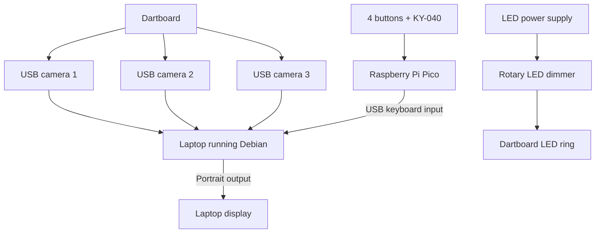
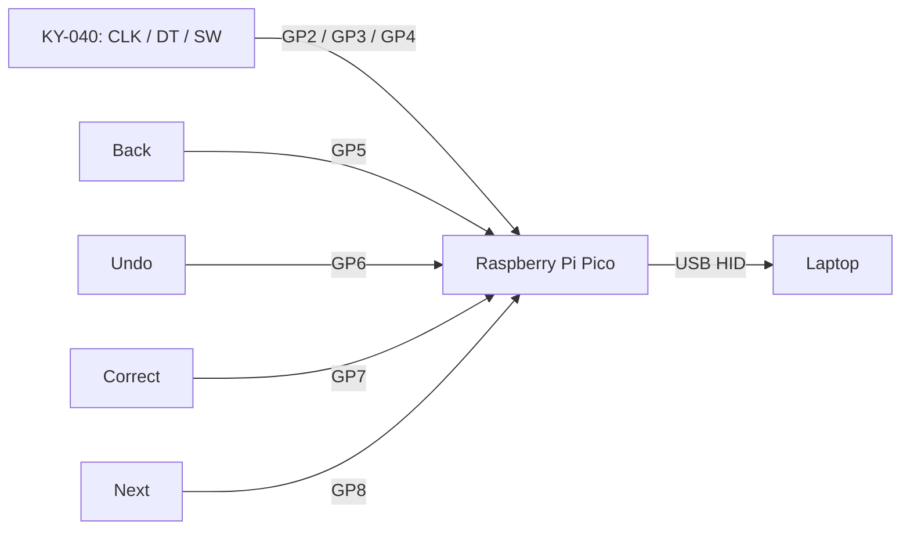
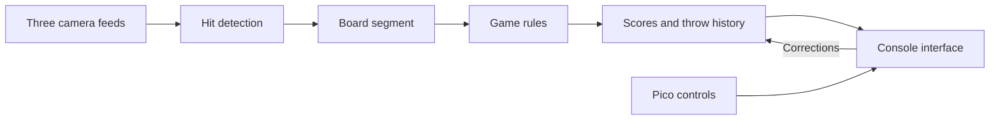
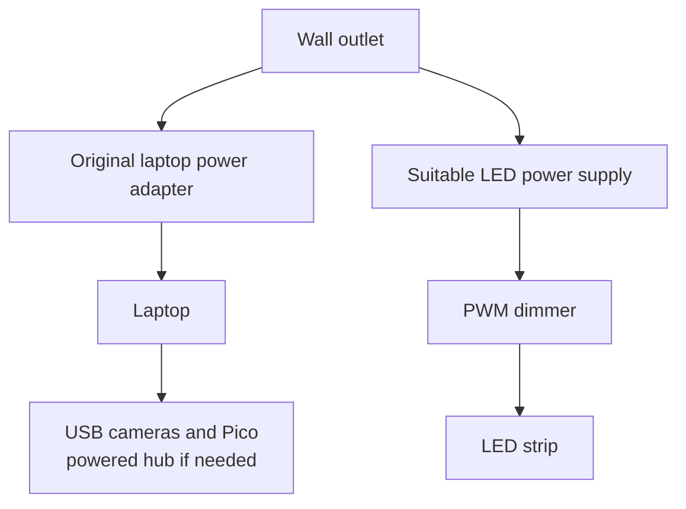

# System layout

## Hardware



The lighting circuit is independent from the laptop and Pico.

## Front panel

```text
       ┌────────────────────────────┐
       │                            │
       │       DARTS CONSOLE        │
       │                            │
       │      Portrait screen       │
       │                            │
       │                            │
       └────────────────────────────┘
        [BACK] [UNDO]  (●)  [CORRECT] [NEXT]
                        KY-040
                      turn / press
```

The drawing shows placement only; it is not to scale.

## Controls



[Full wiring table](WIRING.md)

## Scoring pipeline



This is the intended software flow, not a working camera pipeline. The detection engine, camera calibration, scoring history and correction logic still need to be implemented.

## Power



Use a suitable enclosed LED power supply. Do not expose or modify mains wiring. Check voltage, current draw and dimmer ratings before assembling the LED circuit.
