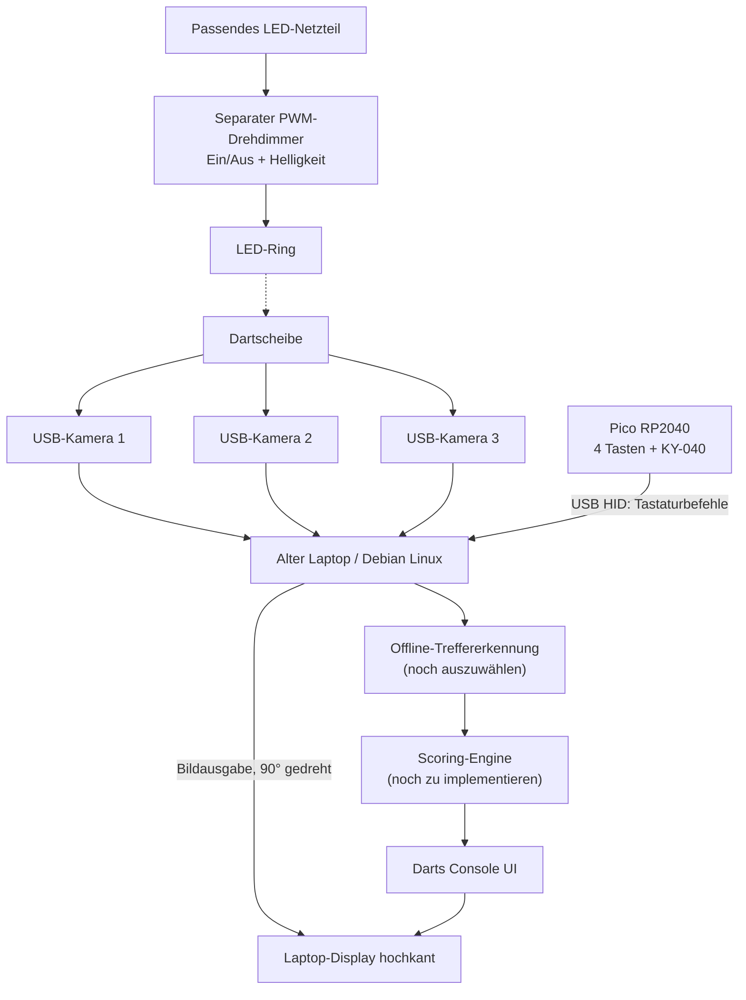
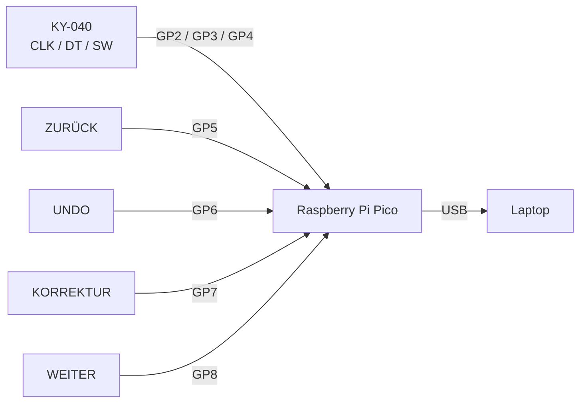
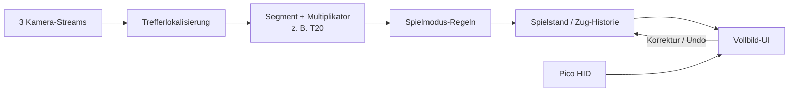
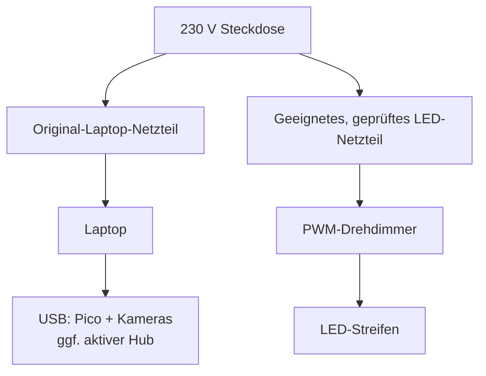

# Architektur und Grafiken

> Planungsstand, **kein Nachweis einer fertigen automatischen Punkteerkennung**. Mermaid-Diagramme werden direkt auf GitHub gerendert.

## 1. Gesamtsystem



**Wichtig:** Die LED-Beleuchtung ist elektrisch unabhängig von Pico und Laptop. Kein LED-Strom über GPIO.

## 2. Gehäuseansicht – Vorderseite, schematisch

```text
       ┌────────────────────────────┐
       │         DISPLAY            │
       │          HOCHKANT          │
       │                            │
       │     Punkte / Spieler       │
       │     Menüs / Spielmodi      │
       │                            │
       └────────────────────────────┘
       [ZURÜCK] [UNDO]  (◉)  [KORR.] [WEITER]
                         KY-040
                      drehen + drücken
```

Die Darstellung ist **nicht maßstabsgetreu**. Tasten und Drehregler befinden sich **alle unter dem Display**.

## 3. GPIO-Zuordnung



Taster jeweils zwischen GPIO und GND; interne Pull-ups aktiviert. KY-040 nur mit 3,3 V betreiben. Detaillierte Tabelle: [WIRING.md](WIRING.md).

## 4. Geplanter Softwarefluss



**Noch offen:** Auswahl und Test einer lokal lauffähigen Kamera-/Scoring-Lösung, Kalibrierung, Synchronisierung der Kameras, zuverlässige Korrekturen und persistente Speicherung.

## 5. Stromversorgung (Blockschaltbild, kein Netzschaltplan)



230-V-Seite **nicht selbst offen verdrahten**. Fertiges, passendes Netzteil verwenden; LED-Spannung, Stromaufnahme, Kabelquerschnitt und Dimmerbelastbarkeit vor dem Kauf abgleichen.
